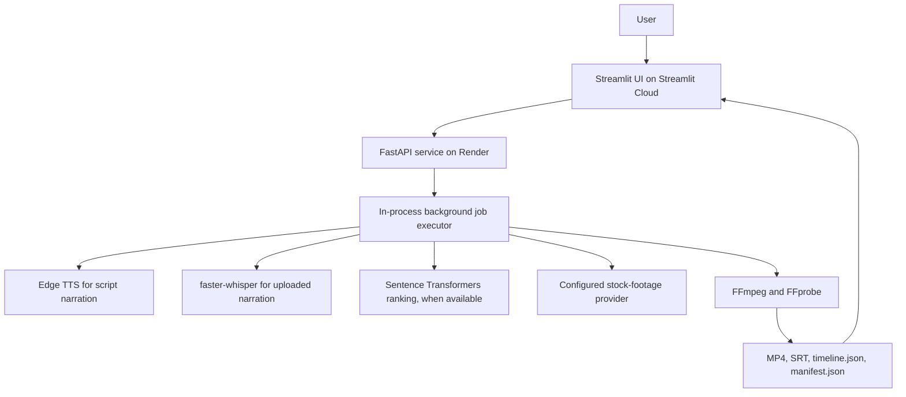

# IncuBrix PS3 — Script and Voiceover to B-roll Video Engine

A Streamlit-based interface for turning a script or narration into a scene-based B-roll video with voiceover, captions, and supporting timeline/manifest metadata. The current demo is deployed as a Streamlit UI with a separately hosted FastAPI processing service.

> **Submission/demo status (20 October 2026):** The Streamlit frontend is deployed and displaying. End-to-end cloud video generation is still being checked: a job submission was accepted by the API, but a later status poll returned a Render 502 HTML response. Treat the live UI as a demo in progress, not proof that every job completes successfully.

## Live demo and repository

- **Streamlit frontend:** https://incubrix-ps3-broll-engine-htngdsxkqfbc5dftgkxu52.streamlit.app/
- **FastAPI backend:** https://incubrix-ps3-broll-engine.onrender.com
- **API health:** https://incubrix-ps3-broll-engine.onrender.com/health
- **API readiness:** https://incubrix-ps3-broll-engine.onrender.com/ready
- **Interactive API docs:** https://incubrix-ps3-broll-engine.onrender.com/docs
- **GitHub repository:** https://github.com/sreevarshiniar/IncuBrix-PS3-Broll-Engine

The Streamlit app's API base URL must point to the deployed backend URL above. The frontend being visible does not by itself confirm the full generation pipeline is healthy.

## Current architecture



## Features implemented in the codebase

- Streamlit UI for entering a script and starting video generation.
- FastAPI endpoints for health/readiness, job creation, upload-based jobs, and job status.
- Script-to-voiceover flow using Edge TTS.
- Audio transcription flow using faster-whisper where configured and available.
- Stock-footage retrieval through the configured provider.
- Semantic text matching using `sentence-transformers/all-MiniLM-L6-v2` when the model is available, with a fallback path for tests.
- FFmpeg-based clip processing and video rendering.
- Caption, timeline, and manifest artifacts.
- Local automated tests for selected API and semantic-matching behaviours.

## Local setup

Requirements: Python 3.11+ (Python 3.12 is also used in the current development environment), FFmpeg and FFprobe on `PATH`, and internet access for voice/model/media services.

1. Create and activate a virtual environment:
   ```powershell
   python -m venv .venv
   .\.venv\Scripts\Activate.ps1
   ```
2. Install dependencies:
   ```powershell
   python -m pip install -r requirements.txt
   ```
3. Copy `.env.example` to `.env` and fill in the credentials for the selected footage provider. Never commit `.env`.
4. Start the API in one terminal:
   ```powershell
   python -m uvicorn app.main:app --reload
   ```
5. In a second terminal, start the UI:
   ```powershell
   python -m streamlit run ui.py
   ```
6. Open `http://localhost:8501`. API docs are at `http://127.0.0.1:8000/docs`.
7. In the Streamlit sidebar, set the API base URL to `http://127.0.0.1:8000` for local testing.

For Windows, add the FFmpeg `bin` directory to `PATH` before starting the terminals if FFmpeg is not already discoverable.

## Deployed flow and current troubleshooting note

1. The browser loads the Streamlit UI.
2. The UI submits a job to `POST /api/v1/broll/jobs` (or the upload endpoint for audio).
3. The API returns a job ID with HTTP 202.
4. The UI polls `GET /api/v1/jobs/{job_id}` for progress and result data.
5. Once finished, the UI presents the output video and any available captions/metadata.

On 20 October 2026, a deployed job creation request returned `202 Accepted`, and repeated status polls returned `200 OK` before a later request surfaced a Render `502` HTML response. The provided log excerpt ended with a new Uvicorn process starting, but did not establish why the process restarted. The service currently uses in-memory job state, so a restart can lose active job records. Investigate Render Events and the logs immediately before the process start before concluding the root cause.

## API endpoints

- `GET /health`
- `GET /ready`
- `POST /api/v1/broll/jobs`
- `POST /api/v1/broll/jobs/upload`
- `GET /api/v1/jobs/{job_id}`
- `GET /api/v1/broll/jobs/{job_id}`
- Generated artifacts are served from the configured output/static path when available.

See `/docs` on the deployed API for the live schema. Do not assume a video URL remains available after a restart unless persistent storage is configured.

## Output artifacts

Depending on the completed job and requested output, the pipeline can produce:

- Rendered MP4 video
- `captions.srt`
- `timeline.json` with scene timing and source-selection metadata
- `manifest.json` with provider/model/settings, warnings, and rights metadata

A recorded source URL or licence field is not proof that the selected asset has been fully rights-cleared.

## Tests and evidence

Run local tests with:

```powershell
python -m pytest -q
```

The latest previously reported local test run was **5 passed**. Re-run the tests against the exact version being submitted and retain the current output as evidence. The batch runner can exercise job cases against a running API; see `test-pack/README.md`.

Do not report a 10-input relevance benchmark, human relevance score, turnaround time, cost per minute, or render success rate unless the corresponding tests were actually run and their evidence saved. Cosine similarity values are not human relevance ratings.

## Important limitations

- Job state and the background executor are in process memory; jobs/idempotency are not durable across restarts and are not coordinated across multiple workers.
- A cloud status-polling request has returned a Render 502 during testing; the cause is not confirmed yet.
- Render local disk can be ephemeral unless persistent storage is configured. Generated files may not survive service replacement/restart.
- A durable task queue, persistent job database, object storage, signed download URLs, HMAC callbacks, and robust cross-provider failover are not confirmed as implemented.
- Full 10-minute inputs, all aspect ratios/audio formats, frozen/black-frame checks, audio drift, safe reframing, safety handling, and all licensing obligations have not been verified end-to-end.
- Semantic ranking and transcription depend on model availability, downloads, and deployment resources.
- Provider/model terms must be checked for the actual assets and services used.

Describe the project as a working prototype/demo with known gaps. Do not mark all assessment must-haves as passed until each one has been tested and backed by evidence.
